# dart_fs — DART 재무제표·주석 raw 엑셀 생성기

회사 하나를 고르면 DART 공시(사업보고서 API·감사보고서 원문)에서 여러 해의 재무제표와 주석 표를 모아,
공시 그대로의 raw 시트와 표준계정 수식 시트(mFS)를 가진 xlsm 한 권을 만든다. 만든 파일은 [업데이트] 버튼으로 다시 채울 수 있다.
공시가 없는 회사는 회사가 준 엑셀 재무제표를 넣어 같은 모양의 xlsm 을 만들 수 있다("파일로 생성").

## 미리보기

> 아래 캡처는 DART 공개 자료인 삼성전자(연결, FY2023~2026 반기)와, 테스트용 가상 회사 "샘플전자"(지어낸 숫자) 엑셀로 만든 산출물이다.

### 화면 (`실행_v2.bat` → http://127.0.0.1:8772)

| DART로 생성 | 엑셀 파일로 생성 |
|---|---|
| 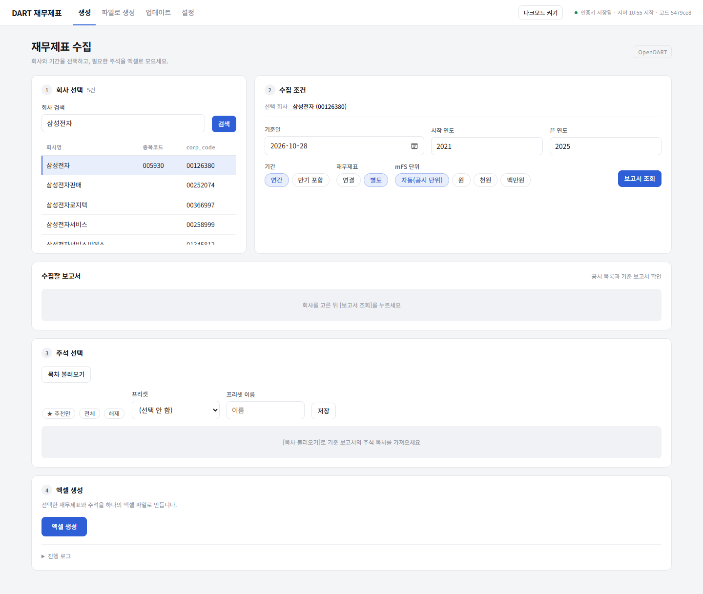 | 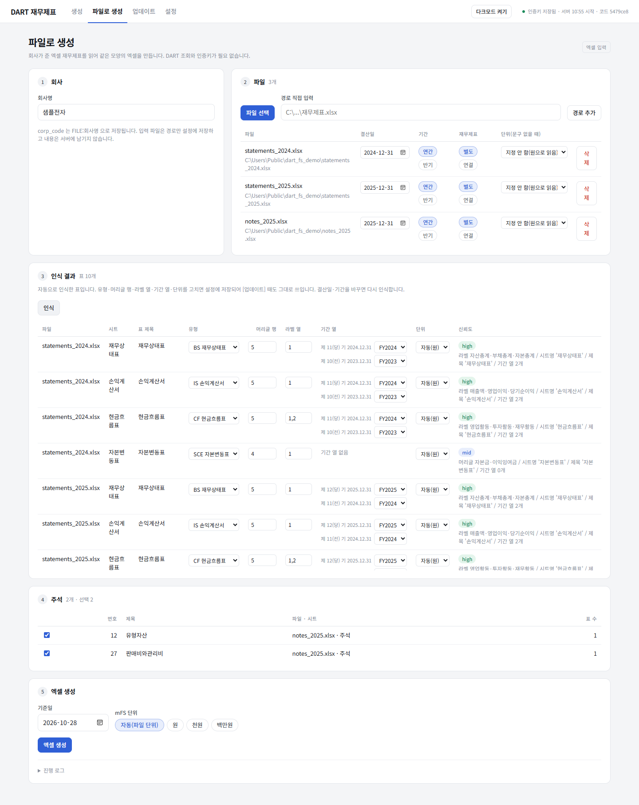 |

### 산출물 — DART (삼성전자)

| 시트 | 캡처 |
|---|---|
| 설정 (표시 단위·검증 안내·[업데이트] 버튼) | 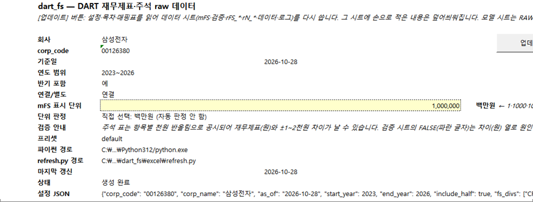 |
| 목차 | 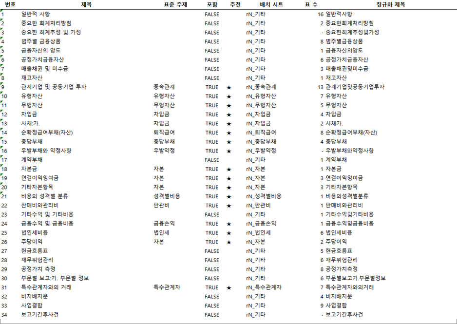 |
| mFS (표준계정, raw 시트 직참조 수식) | 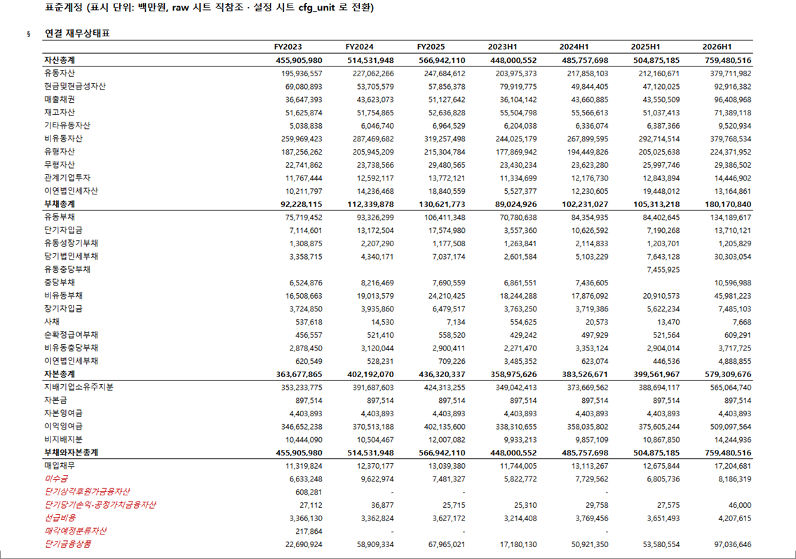 |
| 검증 (A 재무제표 정합·B 주석↔재무제표·C 주석 합계, 천원 반올림 비교) | 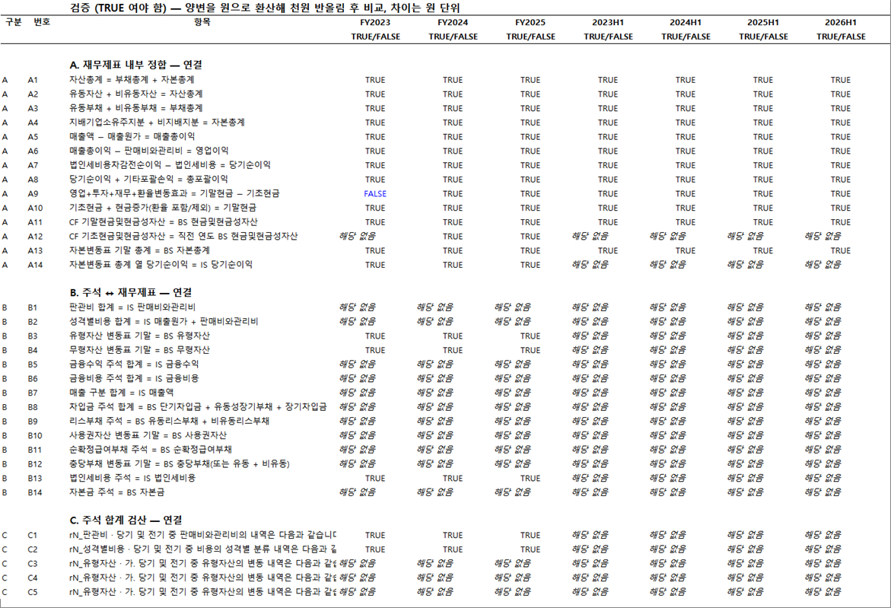 |
| rFS_연결 (공시 원문 그대로) | 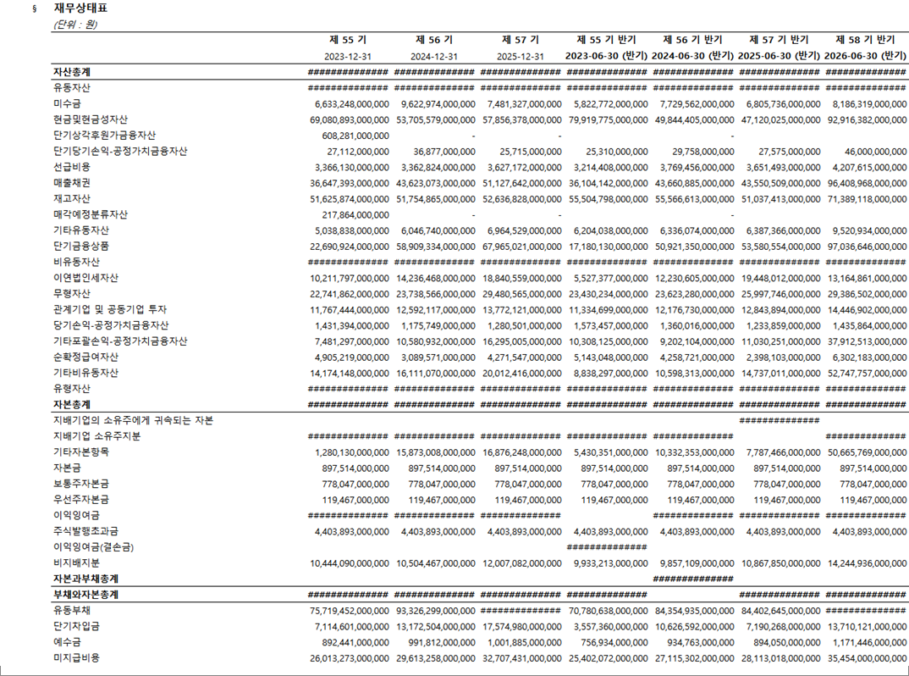 |
| rN_판관비 (주석 주제별 raw) | 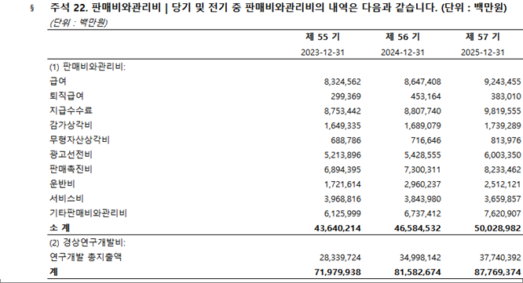 |
| rN_성격별비용 | 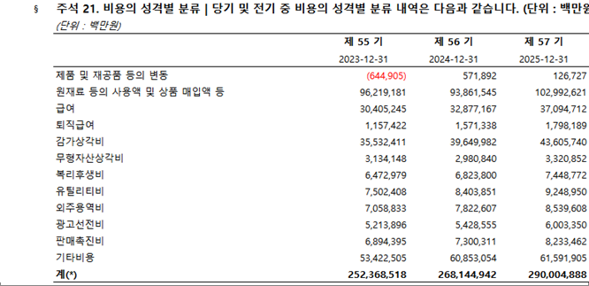 |

검증 FY2023 A9(현금흐름 합계)의 FALSE 는 공시 현금흐름표의 매각예정 분류 조정 행 때문에 실제로 차이가 나는 항목이다.

### 산출물 — 엑셀 파일 입력 (가상 회사 샘플전자)

| 시트 | 캡처 |
|---|---|
| 설정 (입력 파일 경로) | 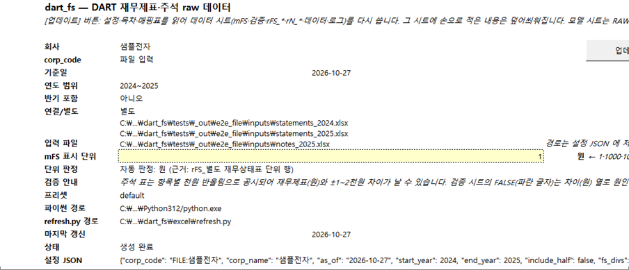 |
| 목차 |  |
| mFS | 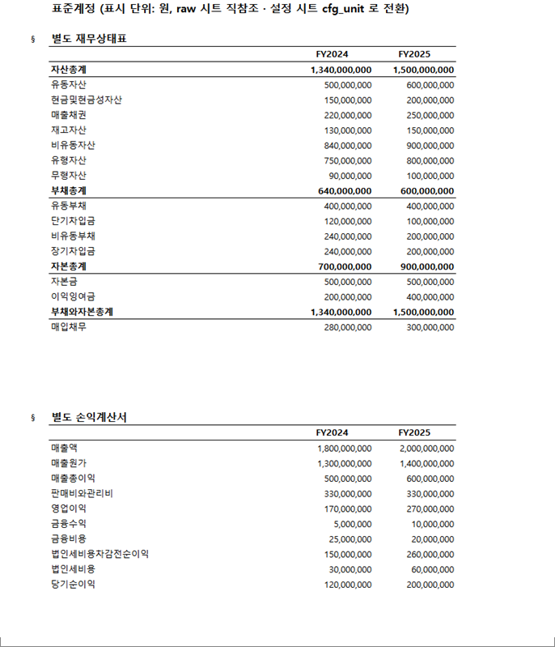 |
| 검증 | 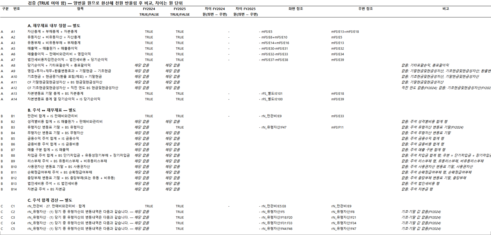 |
| rFS_별도 | 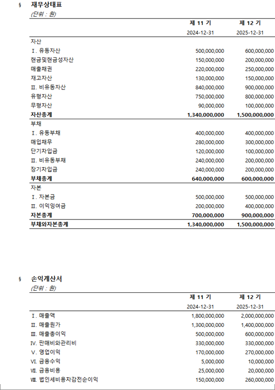 |
| rN_판관비 | 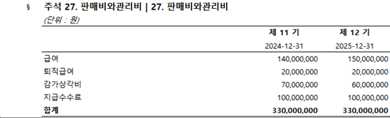 |
| rN_유형자산 | 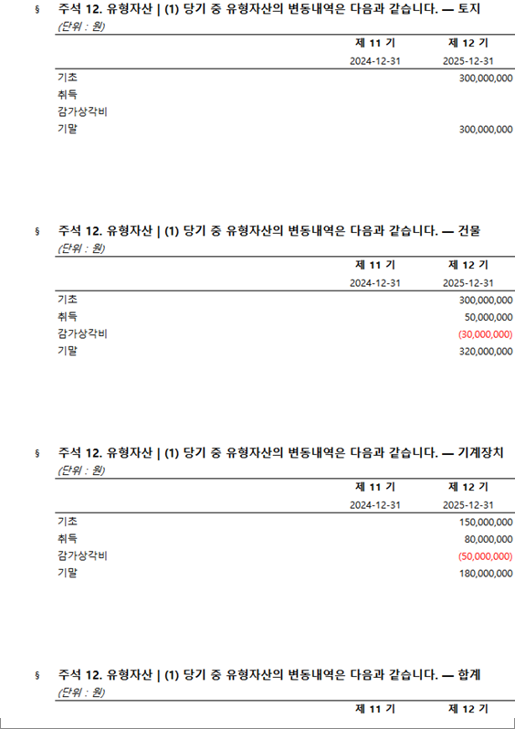 |

## 설치

1. 파이썬 3.12 (`C:\Users\<사용자>\AppData\Local\Programs\Python\Python312\python.exe` 권장. Store 별칭 `python` 은 쓰지 않는다).
2. 패키지: `python -m pip install -r requirements.txt` (requests·openpyxl·pywin32).
3. Excel(데스크톱)이 설치돼 있어야 한다. 보안 센터에서 "VBA 프로젝트 개체 모델에 안전하게 액세스" 를 켜 둔다(VBA·버튼 삽입에 필요).
4. `config.example.txt` 를 `config.txt` 로 복사하고 본인 OpenDART 인증키를 넣는다. 파이썬 경로를 지정하려면 한 줄 더:
   ```
   api_key = <본인 키>
   python = C:\Users\<사용자>\AppData\Local\Programs\Python\Python312\python.exe
   ```
   `config.txt` 는 커밋·공유하지 않는다(.gitignore 에 있음). 화면 상단에서도 키를 입력·저장할 수 있다.

## 실행

- `실행.bat` 더블클릭, 또는 `python server.py` (기본 포트 8771, 브라우저 자동 열림. `--port`, `--no-browser` 옵션).
- 코드를 고친 뒤에는 `실행.bat` 을 다시 실행한다(기존 서버 자동 종료). 화면 상단에 서버 시작 시각·코드 버전이 표시된다.
- 서버는 `127.0.0.1` 에서만 받고, Host·Origin·Content-Type(JSON) 검사를 통과한 요청만 처리한다.

## 화면 흐름

1. **회사 검색** — 회사명·종목코드·corp_code 로 찾아 선택(CORPCODE.xml 캐시).
2. **조건** — 기준일(기본 오늘), 시작~끝 연도, 반기 포함, 연결/별도, mFS 표시 단위(기본 **자동(공시 단위)**, 또는 원·천원·백만원 직접 선택).
3. **보고서 조회** — 쓰일 보고서 목록(기간·종류·rcept_no·정정 여부)과 기간 열을 확인.
4. **주석 목차** — 기준 보고서(가장 늦은 연간 보고서)의 주석 목록. 체크로 포함 여부, ★ 추천, [추천만]·[전체]·[해제], 프리셋 저장·불러오기.
5. **엑셀 생성** — 진행 로그가 실시간으로 보이고, 끝나면 `output\<회사>\<회사>_<기준일>.xlsm` 경로와 [폴더 열기]. 회사 폴더가 없으면 자동 생성하고, 같은 이름 파일이 있으면 해당 회사 폴더에 `backup_<mtime>_rebuild.xlsm` 으로 백업한 뒤 새로 만든다. 기존에 `output\` 바로 아래에 만든 파일은 이동하지 않는다.
   [기존 파일 업데이트] 로 이미 만든 xlsm 을 다시 채울 수도 있다(Excel 에서 닫혀 있을 때).

## 파일로 생성 (회사 제시 엑셀, DART 없이)

비공시 회사가 준 엑셀 재무제표(xlsx·xlsm)를 넣으면 같은 모양의 xlsm 이 나온다. `실행_v2.bat`(포트 8772) 화면의 **파일로 생성** 탭. 인증키가 필요 없다.

1. **회사** — 회사명 입력(산출물 폴더·파일 이름, corp_code 는 `FILE:<회사명>`).
2. **파일** — [파일 선택](서버 PC 의 파일 선택 창) 또는 경로를 붙여 넣고 [경로 추가]. 파일마다 결산일(표 머리글의 당기 날짜로 자동 채움, 없으면 직접 입력)·연간/반기·연결/별도·단위(**시트의 `(단위: 천원)` 문구가 우선**, 여기 고른 단위는 그 문구가 없는 표에만 쓰는 값).
3. **인식 결과** — 파일을 넣으면 바로 시트별 표를 인식해 유형(BS/IS/CIS/CF/SCE/주석/기타)·머리글 행·라벨 열·기간 열↔기간(FY2025/FY2024/…/제외)·단위·신뢰도를 보여 준다. 고친 값만 설정 JSON 의 `layout` 에 저장되어 [업데이트] 때도 쓰인다.
   `제 12 기` 처럼 회차만 있어 역할을 추정한 표는 **확인 필요** 표시 — 기간 열을 확인한다. 결산일·연간/반기·유형을 바꾸면 다시 인식한다.
4. **주석** — 인식된 주석 표 제목별 체크(연간 파일의 주석 표만 쓴다).
5. **엑셀 생성** — 기준일·mFS 단위 → `output\<회사>\<회사>_<기준일>.xlsm`. 입력 파일은 경로만 설정 시트에 저장하고 내용은 서버·캐시에 남기지 않는다.
   연도 범위는 파일 결산일과 기간 열 매핑에서 자동으로 정한다(머리글의 전기·전전기 열 포함, 숨김 시트·반기 파일의 주석 표는 빼고).

### 처리 흐름

입력 파일 → 표 인식(`core\xlsx_input.py`, openpyxl 읽기 전용) → 기간·단위·주석 판정 + 사용자 수정값(`layout`) 적용(`core\file_collect.py`)
→ DART 경로와 같은 `Collected` → 같은 compose·검증·finalize(Excel COM 재계산·VBA 버튼). 그래서 시트 구성·`검증` 시트·[업데이트] 동작이 DART 기반 파일과 같다.
[업데이트] 는 `설정` 의 입력 파일 경로를 다시 읽는다(끝 연도는 올리지 않음). 파일을 고쳐 저장한 뒤 누르면 바뀐 값이 반영된다.

### 받는 양식

- 재무제표 시트: 시트마다 재무상태표·손익계산서(또는 포괄손익계산서)·현금흐름표·자본변동표, 또는 한 시트에 표 여러 개(예: 손익계산서 아래 포괄손익계산서).
- 머리글: `제 12(당) 기 | 제 11(전) 기`, `당기 | 전기`, `당반기 | 전반기`, `2025.12.31`·`2025-12-31`·`2025년`·`FY2025`, `당기말 | 전기말`. 2행 머리글(`제 12 기` 아래 날짜)은 두 행을 합쳐 본다.
- 자본변동표: 열 = 자본 구성요소(자본금·이익잉여금…), 행 = `2025.1.1(당기초)` 같은 연도 표기 행. 기간 열이 있는 가로형도 받는다.
- 주석 시트: `27. 판매비와관리비`·`주석 12 유형자산` 같은 제목 아래 당기/전기 표, 변동표(열 = 자산 종류, 행 = 기초·취득·상각·기말). 기간 열이 없으면 위 캡션의 `당기`/`전기` 표기로 기간을 잡고, 그것도 없으면 원표 그대로 `rN_기타` 로.

### 인식 규칙

- **표 찾기**: 시트를 위→아래로 훑어 기간 표식 셀이 2개 이상인 행(또는 자본 구성요소 머리글 행)을 머리글로 보고, 그 아래 라벨 열에 글자·값 열에 숫자나 `-` 가 있는 행을 본문으로 읽는다. 빈 행 2개나 다음 머리글에서 끝. 머리글 위 몇 행의 글자를 제목·캡션으로.
- **유형**: 라벨 키워드 점수 — BS(자산총계·부채총계·자본총계 중 2개 이상), IS(매출액·영업이익·당기순이익), CIS(총포괄·기타포괄), CF(영업·투자·재무활동 현금흐름 2개 이상), SCE(제목·구성요소 머리글), 주석(제목의 번호+주제 키워드), 나머지는 **기타**. 시트 이름이 재무상태표 등이면 가중. 불확실하면 `기타` 로 두고 로그에 남긴다(재무제표로 추정해 넣지 않음).
- **기간 열**: 사용자 수정값(`layout`) → 당기/전기 역할 → 머리글 날짜(`2025년 1월 1일부터 2025년 12월 31일까지` 는 마지막 날짜가 기말) → 회차(`제 N 기`)만 있을 때 파일 결산일 기준으로 역할 추정(**확인 필요** 표시) → 모르면 제외. 같은 기간이 여러 열에 걸치면(금액·구성비, 반기의 `3개월`·`누적`) 하위 머리글에 `누적` 이 있는 열, 없으면 첫 숫자 열 — 값 열 전부가 화면에 보이므로 다른 열로 바꿀 수 있다.
- **자본변동표 행**: 라벨의 연도(`2025.1.1(당기초)`) → 연도가 없으면 `전기초`·`당기말` 같은 경계 행으로 전기/당기 구간을 나눈다 → 그것도 없으면 전부 당기(로그).
- **수식만 있는 파일**: Excel 이 아닌 도구로 만들어 계산값이 없는 시트는 숫자가 보이지 않아 표를 못 찾는다 — 인식 결과에 `수식 셀의 계산값이 없는 파일` 로 표시되고 로그에 `인식된 표 없음(…Excel 에서 한 번 저장한 뒤 다시 넣으세요)` 가 남는다.
- **결산일 자동 채움**: 당기 열 날짜 중 가장 늦은 것(없으면 모든 날짜 중 가장 늦은 것, 연도만 있으면 12-31). 6월이면 반기로 본다.
- **단위**: 표 위 `(단위 : 천원)`·`단위: 백만원`·`(천원)` 문구 → 없으면 파일 목록에서 고른 단위 → 그것도 없으면 원으로 읽고 로그에 `단위 미표기`.
- **연간/반기·재작성**: FY 열은 연간 파일에서만, 반기 열은 반기 파일에서만 만든다. 반기 파일의 재무상태표 전기말 열은 기록만 하고 FY 출처로 쓰지 않는다. 두 연도 파일이 겹치면 결산일 늦은 파일의 전기 열을 우선(DART 의 재작성 기준과 같음)하고 차이는 `로그` 에.
- **주석**: 연간 파일의 주석 표만 쓴다(반기 주석 없음 — DART 경로와 같음). 표준 주제(`rN_*`)는 DART 와 같은 사전으로 정한다.

### 한계(지원하지 않는 것)

- **`.xls`**: 받지 않는다(`xls 는 아직 지원하지 않습니다 — Excel 에서 xlsx 로 저장한 뒤 넣어 주세요`). xlsx·xlsm 만.
- **시산표·계정별 원장**: 계정코드·차변·대변 형식은 재무제표로 바꾸지 않는다 — `기타` 로 로그에만 남는다.
- **PDF(특히 스캔 PDF)·이미지·한글(hwp)**: 받지 않는다. 엑셀로 옮긴 뒤 넣는다.
- 12월 결산(반기는 6월)이 아닌 파일은 건너뛴다(로그 표시). 분기 파일도 1차 범위 밖.
- 수식 셀은 Excel 이 저장해 둔 값을 읽는다(openpyxl `data_only`). Excel 이 아닌 도구로 만들어 계산값이 없는 파일은 값이 비어 보일 수 있다 — Excel 에서 열어 저장한 뒤 넣는다.
- 시트는 파일당 앞 60개, 시트당 20,000행·80열까지 본다. 숨김 시트는 인식 결과에 보이지 않고 쓰지 않는다.
- 사용자 수정값은 `<파일명>|<시트>|<표 번호>` 키로 저장되므로, 파일의 시트 이름을 바꾸거나 표 순서가 바뀌면 [업데이트] 때 그 수정값이 적용되지 않는다.

### 서버 API(실행_v2.bat, 포트 8772)

- `POST /api/file/scan` {files:[{path, period_end?, kind?, fs_div?, unit?}], layout?} → 파일별 인식 결과(셀 내용은 담지 않음).
- `POST /api/file/build` {cfg} → 생성 job. corp_code 는 항상 `FILE:<회사명>`(보낸 값 무시), source 는 항상 `file`.
- `POST /api/pick-files` → 서버 PC 의 파일 선택 창. 10분 안에 닫지 않으면 시간 초과 오류(경로를 직접 붙여 넣기).
- 절대 경로만 받는다. Host·Origin·JSON 검사는 다른 엔드포인트와 같다. `POST /api/build` 는 DART 전용(source 는 항상 `dart`).
- 끝까지 돌려 보기: `python scripts\e2e_file.py` (가상 `샘플전자` 픽스처 → Excel COM 마무리 → 오류 셀·검증 TRUE/FALSE 출력, 결과 `tests\_out\e2e_file\`).

## 엑셀 구성

시트 순서: `설정` → `목차` → `mFS` → `검증` → `RAW >>` → `rFS_연결` / `rFS_별도` → `rN_*` → `rN_기타` → `데이터` → `매핑표` → `로그`.

| 시트 | 내용 |
|---|---|
| `설정` | 회사·corp_code·기준일·연도 범위·반기·연결/별도·표시 단위(`cfg_unit`, 연노랑·점선 입력 칸, 목록 1·1000·1000000 + 오른쪽 단위 글자)·단위 판정·검증 안내(주석 천원 반올림 ±1~2천원 차이 안내)·프리셋·파이썬 경로·마지막 갱신·상태, **[업데이트] 버튼** |
| `목차` | 기준 보고서 주석 번호·제목·표준 주제·포함(TRUE/FALSE)·추천·배치 시트·표 수. 여기서 포함을 바꾸고 업데이트하면 반영 |
| `mFS` | 표준계정 × 기간. 값이 아니라 `='rFS_별도'!E7/cfg_unit`·`='rN_x'!E7*1000/cfg_unit` 같은 raw 직참조 수식(공시 단위 → 원 → 표시 단위). 매핑 안 된 raw 행은 블록 끝에 원계정명 + `미매핑`(값이 하나도 없는 제목 행 `자 산` 등은 제외 — rFS 에는 남음). 맨 아래 연결/별도별 `검증 요약` 3행(`검증` 시트의 TRUE·FALSE·해당 없음 수를 기간 열마다 COUNTIF — 오류값(#REF! 등)이 된 검증 셀은 COUNTIF 가 세지 않지만 생성·업데이트 때의 verify(상태 셀·로그)는 FALSE 로 센다) |
| `검증` | 검증식 시트(TRUE 여야 함). 연결·별도마다 **A. 재무제표 내부 정합**(A1~A14: 자산=부채+자본, 유동+비유동, 매출총이익·영업이익·당기순이익·총포괄이익 단계, 현금흐름표 합산·기초/기말, CF 기말=BS 현금, CF 기초=직전 연도 BS 현금, 자본변동표 기말 총계=BS 자본총계·당기순이익 행=IS) · **B. 주석 ↔ 재무제표**(B1~B14: 판관비·성격별비용·유형/무형자산 변동표 기말·금융수익/비용·매출 구분·차입금·리스부채·사용권자산·순확정급여부채·충당부채·법인세비용·자본금) · **C. 주석 합계 검산**(`rN_*` 모든 블록: 합계 행 = 위 행들의 합(소계가 있으면 소계만, 비율 행 제외), 변동표 기초 + 변동 = 기말). 열: 구분·번호·항목·기간별 TRUE/FALSE·기간별 차이(원)·좌변/우변 참조·비고. 참조할 셀이 하나라도 없으면 `해당 없음` + 비고에 무엇이 없는지 |
| `RAW >>` | 구분용 시트. **모델 시트는 이 앞에 둔다** |
| `rFS_연결` `rFS_별도` | 재무상태표 → 손익(포괄손익)계산서 → 현금흐름표 → 자본변동표 세로 적층. 블록마다 제목·단위·헤더 2줄(`제 N 기` / 기말일, 반기는 `2026-06-30 (반기)`). D열 계정명은 공시 그대로, E열부터 연간 열, 그 오른쪽에 반기 열 |
| `rN_*` | 표준 주제별 주석 표(판관비·성격별비용·금융손익·유형자산·무형자산·차입금·리스·매출구분·종속관계·특수관계자·법인세·충당부채·퇴직급여·자본·우발약정). `항목 × 당기/전기` 표는 블록 하나(`항목 × 기수`), 변동표처럼 열이 여러 개인 표는 **열마다 블록**(`구분 × 기수`) |
| `rN_기타` | 표준 주제가 아니거나 기간 열을 알 수 없는 표를 연도별 원표 그대로 |
| `데이터` | 모든 레코드의 롱포맷(시트·블록·열라벨·행라벨·기간·값·단위·rcept_no·출처·표준계정) |
| `매핑표` | 표준계정(account_id)·키워드·주석 주제 사전. 고치면 업데이트 때 반영 |
| `로그` | 사용한 보고서 목록(정정본·대체된 접수번호), 재작성 차이, 감사인·의견, 처리 메시지 |

raw 시트 값은 공시 단위 그대로 두고 단위 행에 표기한다. 환산은 mFS 수식에서만 한다.

### 표시 단위

- **자동(기본)**: 수집이 끝나면 주 재무제표(연결을 고르면 연결, 아니면 별도)의 재무상태표 공시 단위를 그대로 쓴다
  (원문 XML 은 제목표의 `(단위 : 천원)`, 사업보고서 API 는 항상 원). 재무상태표 단위가 없으면 손익계산서, 그것도 없으면 원.
  판정 결과와 근거는 `설정` 의 `단위 판정` 행과 `로그` 시트(`표시 단위 자동 판정: 천원 (근거: rFS_별도 재무상태표 단위 행)`)에 남는다.
- **엑셀에서 즉시 변경**: `설정` 의 `mFS 표시 단위` 셀(`cfg_unit`)을 목록에서 1·1000·1000000 으로 바꾸면 [업데이트] 없이
  mFS 값과 제목의 단위 글자가 바로 바뀐다. `검증` 시트의 검증식은 mFS 셀에 `cfg_unit` 을 곱해 원으로 되돌린 뒤 비교하므로
  단위를 바꿔도 TRUE/FALSE 가 같다.
- **[업데이트] 때**: 자동으로 만든 파일에서 셀을 그대로 두었으면 다시 판정해 `cfg_unit` 을 새로 쓴다. 셀을 바꿨으면
  (또는 처음부터 원·천원·백만원을 골랐으면) 그 값을 그대로 쓴다. 다시 자동으로 돌리려면 셀을 `단위 판정` 의 판정값으로 되돌린다.
- `데이터` 시트와 raw 시트는 단위 설정과 무관하게 공시 단위 그대로.

## [업데이트] 동작과 주의

- 버튼을 누르면 통합문서를 저장하고 `excel\refresh.py` 를 실행한다. 먼저 같은 폴더에 `backup_<mtime>_update.xlsm` 백업을 만든다.
- **기준일은 오늘로, 끝 연도는 max(저장된 끝 연도, 올해)로 올려** 새 공시(새 사업·반기보고서)를 받는다. 시작 연도는 그대로. 바뀐 기준일·연도 범위는 `설정` 에 다시 적는다.
- `설정`·`목차`·`매핑표` 를 읽어 다시 수집하고, **데이터 시트(`목차`·`mFS`·`검증`·`rFS_*`·`rN_*`·`데이터`·`로그` 등)만 다시 쓴다.** 그 시트에 손으로 적은 내용은 덮어써진다.
- 사용자가 추가한 시트(모델 시트 등)는 손대지 않는다.
- **행·열 위치(모델 수식 보호)** — `mFS`·`rFS_*`·`rN_*` 의 각 블록(C열 `§` 표식 행)은 업데이트 전과 같은 시작 행에 다시 쓴다.
  - 블록 안 기존 행은 순서를 지키고, 새 계정은 블록 끝에 붙는다. 공시에서 사라진 계정은 행을 남기고 값만 비운다(`공시에서 사라짐`).
  - 블록 사이 여유 행 5개가 블록 끝 추가를 흡수한다. **5행을 넘게 늘면 그 아래 블록이 밀리고**, `로그` 와 `설정` 상태에 `"<시트> '<블록>': 블록이 n행 밀림 — 모델 참조 확인 필요"` 경고가 남는다. 이때는 그 블록을 가리키는 모델 수식을 확인해야 한다.
  - 새 블록은 마지막 블록 뒤에 붙는다. 이번 수집에 없는 블록은 그 자리를 비워 둔다(로그에 표시).
  - 기간 열은 기존 순서 그대로 두고 새 기간을 오른쪽에 붙인다(그래서 업데이트 뒤에는 연간 열 사이에 반기 열이 끼어 있을 수 있다). 이번에 없는 기간도 열은 남는다.
- 파일이 Excel 에 열려 있으면 그 통합문서에 직접 쓰고 **저장은 하지 않는다 — 확인 후 Ctrl+S.** 닫혀 있으면 별도 Excel 인스턴스로 열어 갱신·저장한다. 다른 곳에서 파일을 잡고 있으면(`~$` 잠금 파일) 거부한다.
  Excel COM 을 아예 쓸 수 없을 때만 openpyxl 로 저장하는데, 이 경우 버튼·VBA 복원과 재계산·검증은 하지 않는다(로그·상태에 표시).
- 결과는 `설정` 상태 셀("업데이트 완료 … | 오류 n | 검증 TRUE n FALSE n")과 `로그` 에 남는다.
- **버튼 실행은 창이 보이지 않는다. 진행 로그와 오류 추적은 통합문서 폴더의 `dart_fs_update.log` 에 실행마다 덧붙는다.**
  잠금 파일 거부처럼 통합문서를 열기 전에 실패하면 상태 셀을 고칠 수 없으므로, 상태가 "업데이트 실행 중…" 에서 멈춰 있으면 이 로그 파일을 본다.
- 보안: VBA 는 `설정` 시트의 **파이썬 경로·refresh.py 경로를 그대로 실행한다.** 다른 사람에게서 받은 파일은 버튼을 누르기 전에 `설정` 의 두 경로가 본인 PC 의 파이썬·dart_fs 인지 확인한다.

## 판단 기준 요약

- **재작성 기준**: 각 연도 값은 그다음 해 보고서의 전기 열(재작성 반영)을 우선 쓰고, 다음 해 보고서가 없을 때만 그 해 보고서 당기 열. 원보고서와 값이 다르면 `로그` 의 재작성 차이 표에 양쪽 값과 출처를 남긴다. 반기 열도 다음 반기보고서 전기 열 우선.
- **정정본 우선**: 같은 보고서에 기재정정이 있으면 최신 정정본, 원본 접수번호는 로그에.
- **연도 결합은 정확일치만**: 계정명(공백 정규화)이 정확히 같을 때만 한 행. 이름이 바뀐 계정은 합치지 않고 별도 행. 표준화는 mFS 몫.
- **매핑 3단계**: account_id → 키워드(정확·시작·포함, 우선순위) → 실패 시 원계정명 그대로 `미매핑`.
- **원문에 없는 합계는 만들지 않는다.** 확인은 `검증` 시트의 검증식(TRUE/FALSE)으로만. 양변을 원으로 환산해 **천원으로 반올림한 값이 같은지** 본다
  (`=ROUND(L/1000,0)=ROUND(R/1000,0)`, 차이 열은 원 단위 `=ROUND(L-R,0)`). 허용폭(±1)은 없다 — 천원 반올림 경계에 걸리는 단수차(예: 차이 784원이 …297 vs …298 천원이 되는 경우)는 FALSE 로 남고 차이 열에 금액이 보인다.
- 검증식의 주석 블록 선택: 합계 검증은 열 라벨 없는 블록의 `합계` 행, 변동표 검증은 **기초·기말이 모두 있는 변동표만**(행 변동표의 `기말…` 행, 또는 열마다 블록인 변동표의 기말/장부금액 열 합계 행 — 같은 표에 기초 열이 있을 때만). 합계 행만 있는 내역표(가상자산 장부가액 표 등)는 고르지 않는다.
- 재무제표 수치: 사업보고서 제출사는 OpenDART 전체 재무제표 API, 아니면 감사보고서 원문 XML. 주석은 항상 원문 XML.

## 알려진 한계

- 상장사(사업보고서 API 경로) `rFS` 행 순서·계정명은 OpenDART API 의 `ord`·`account_nm` 그대로라 공시 화면 순서와 다를 수 있다(예: 재무상태표가 `자산총계` 부터). `I.`·`1.` 같은 번호도 없다.
- 반기 열은 재무제표만 있다. 반기 주석은 만들지 않는다(아래 범위 밖).
- 검증식은 천원 반올림 비교에 허용폭이 없어, 주석 합계가 천원 단위 항목의 합이라 생기는 공시 자체의 단수차가 반올림 경계에 걸리면 FALSE 로 남는다(숫자는 고치지 않음, 차이 열로 크기 확인).
- C 그룹 합계 검산은 표의 성격을 모르고 `위 행들의 합 = 합계` 만 본다. 다만 캡션에 회계이익·유효세율 이 든 표(법인세비용과 회계이익의 관계 등, 첫 행 회계이익이 합산 대상이 아닌 조정표)는 C-합계에서 빼고 `해당 없음(조정표)` 로 둔다.
- C 그룹 FALSE 는 라벨 없는 소계성 행(총 비용·순액 등) 때문일 수 있음 — 원문 표에서 그 행이 합계에 이미 포함된 소계인지 확인.
- 손실·수익 표기(영업손실·법인세수익)를 비용 계정으로 매핑하므로 부호가 반대인 회사는 A6·A7 차이가 2×금액으로 나타남 — 부호 확인.
- 현금흐름표 A9·A10 은 원문의 `현금및현금성자산의증가` 에 환율변동효과가 들어 있든 아니든 같은 식을 쓴다(표시 방식 중립): A9 `영업+투자+재무+환율변동효과 = 기말현금 − 기초현금`, A10 은 환율변동효과 행이 있으면 `OR(기초+증가 = 기말, 기초+증가+환율 = 기말)` 로 어느 쪽이든 인정(비고 표기), 없으면 `기초+증가 = 기말`.

## 1차 범위 밖

- 반기 주석(반기보고서 첨부에 검토보고서 원문이 없어 주석은 연간 보고서만)
- 분기보고서, 여러 회사 일괄 생성, 금융업(은행·보험) 재무제표 체계, 영문 공시

## 테스트

```
set PYTHONIOENCODING=utf-8
python -m unittest discover -s tests            # 단위 테스트(네트워크·Excel 불필요, COM 테스트는 건너뜀)
set DART_FS_COM_TESTS=1
python -m unittest discover -s tests            # Excel COM 테스트 포함
python scripts\e2e.py --only ob                 # 실제 DART·Excel 끝까지(비상장 감사보고서 경로)
python scripts\e2e.py --only hugel              # 실제 DART·Excel 끝까지(상장 API 경로, 연결+별도, 반기)
```

E2E 는 `config.txt` 의 인증키로 실제 DART 를 호출하고(응답은 `cache\` 에 저장), 결과를 `tests\_out\e2e\` 에 쓴다.
확인 항목과 마지막 결과는 `tests\e2e_checklist.md`.
